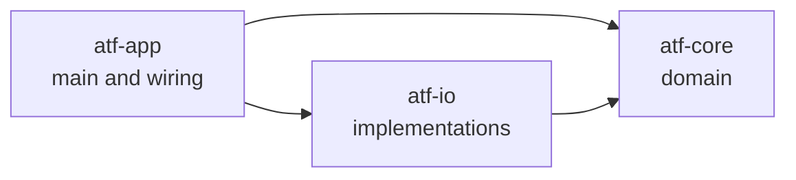

# ATF Thermal Degradation Engine

A modular Java library and demo application that computes the **kinematic viscosity of an automatic transmission fluid (ATF) at any temperature** and tells the caller whether the result can be trusted.

Every result carries a status. A value inside the fluid's validated temperature range is `VALID`. A value outside it is still computed, but flagged `EXTRAPOLATED`, so no caller can mistake an extrapolation for a measurement.

**Release:** `v0.1` | **Java:** 25 | **Build:** Maven (multi-module) | **Tests:** 39, all passing

---

## Table of contents

1. [Overview](#overview)
2. [Architecture](#architecture)
3. [The viscosity model](#the-viscosity-model)
4. [Domain model](#domain-model)
5. [Error handling](#error-handling)
6. [Testing](#testing)
7. [Build and run](#build-and-run)
8. [Design decisions](#design-decisions)
9. [Sources and assumptions](#sources-and-assumptions)
10. [Limitations and roadmap](#limitations-and-roadmap)

---

## Overview

ATF thins out as it heats. Engineers need the viscosity at the working temperature, but a datasheet only lists it at two points (typically 40 °C and 100 °C). This project fits a documented model through those two points and answers *"what is the viscosity at T?"* for any T, while being explicit about when the answer is outside the range the datasheet supports.

What the project demonstrates:

- **Dependency Inversion.** The domain core defines the interfaces and depends on nothing else. Infrastructure plugs in from outside.
- **Immutable value objects** (Java records) that validate themselves on construction.
- **A deliberate exception design** that separates caller bugs, bad data and recoverable domain failures.
- **Boundary-focused tests**, including floating-point edge cases, and hand-written fakes instead of a mocking framework.

---

## Architecture



| Module | Responsibility | Depends on |
|---|---|---|
| `atf-core` | Value objects, interfaces, calculator, `ViscosityMonitor` use case | JDK only (plus test libraries) |
| `atf-io` | `InMemoryFluidRepository`, `SimulatedThermalSensor`, `BuiltInFluids` | `atf-core` |
| `atf-app` | `Main`: the composition root that picks concrete classes and wires them | `atf-core`, `atf-io` |

### Interfaces owned by core

| Interface | Implemented in | Role |
|---|---|---|
| `ViscosityCalculator` | core (`AndradeViscosityCalculator`) | Pure computation, no I/O |
| `FluidRepository` | io (`InMemoryFluidRepository`) | Fluid id in, `FluidSpec` out |
| `ThermalSensor` | io (`SimulatedThermalSensor`) | Supplies the current temperature |

`ViscosityMonitor` (in core) receives all three as interfaces through its constructor. It never references a concrete io class, which is why it can be tested in core with fakes and no io module on the classpath.

### Package layout

```
atf-core   com.mechanics.atf.core
             model/        Temperature, TemperatureRange, KinematicViscosity,
                           TemperatureViscosityPoint, FluidSource, FluidSpec, ViscosityResult
             calculation/  ViscosityCalculator, AndradeViscosityCalculator
             repository/   FluidRepository
             sensor/       ThermalSensor
             service/      ViscosityMonitor
             exception/    AtfDegradationEngineException and its subclasses
atf-io     com.mechanics.atf.io
             InMemoryFluidRepository, SimulatedThermalSensor, BuiltInFluids
atf-app    com.mechanics.atf.app
             Main
```

---

## The viscosity model

**Andrade equation, fitted through two datasheet reference points** (an assumed model; see [Sources and assumptions](#sources-and-assumptions)):

```
ln(v) = A + B / T          T in kelvin, v in cSt

B = ln(v1 / v2) / (1/T1 - 1/T2)
A = ln(v1) - B / T1
```

For the bundled Toyota ATF WS fluid (v1 = 23.0 cSt at 40 °C, v2 = 5.30 cSt at 100 °C): **A = -5.9929, B = 2858.56 K**.

| Temperature | Viscosity | Status |
|---|---|---|
| 30 °C | 31.08 cSt | `EXTRAPOLATED` |
| 40 °C | 23.00 cSt | `VALID` (reference point) |
| 70 °C | 10.35 cSt | `VALID` |
| 100 °C | 5.30 cSt | `VALID` (reference point) |
| 110 °C | 4.34 cSt | `EXTRAPOLATED` |

The status is decided by comparing **Celsius values** against the fluid's validated range. Comparing after conversion to kelvin would lose the last bit of a double next to the boundary (see [Design decisions](#design-decisions)).

---

## Domain model

All model types are immutable records that reject invalid state in their constructors.

| Type | Meaning | Notable rules |
|---|---|---|
| `Temperature` | A temperature, stored in Celsius, `toKelvin()` available | Rejects non-physical values |
| `TemperatureRange` | A validated interval | Minimum must be below maximum; `contains` is inclusive at both edges |
| `KinematicViscosity` | Viscosity in centistokes | Must be finite and positive |
| `TemperatureViscosityPoint` | One datasheet reference point | Temperature plus viscosity |
| `FluidSource` | Where the data came from | Non-blank document name, year and month |
| `FluidSpec` | A fluid: source, name, validated range, two reference points | Non-blank name; reference points inside the validated range; viscosity must strictly decrease with temperature |
| `ViscosityResult` | A computed viscosity plus its status | `VALID` or `EXTRAPOLATED`; neither field may be null |

---

## Error handling

The rule: **can the caller recover?** If yes, the exception is checked. If the failure means the calling code is wrong, it is unchecked.

| Situation | Exception | Kind |
|---|---|---|
| Unknown fluid id (message contains the id) | `FluidNotFoundException` | Checked: choose another id |
| Sensor cannot deliver a reading | `SensorReadException` | Checked: retry or fall back |
| No finite positive viscosity exists (for example a reading just above absolute zero) | `ViscosityNotComputableException` | Checked: reject the reading |
| `null` argument | `NullPointerException` | Unchecked: caller bug |
| Blank or invalid data (blank name, blank id, bad range) | `IllegalArgumentException` | Unchecked: bad data |

The three domain exceptions share the base class `AtfDegradationEngineException`, so an application can handle all of them in a single `catch`.

Note what is *not* an exception: a temperature outside the validated range. The caller still receives the computed number, together with the `EXTRAPOLATED` flag. Throwing would discard useful data.

---

## Testing

**39 tests** (JUnit 5 API, AssertJ), all passing.

| Module | Test class | Tests | Covers |
|---|---|---|---|
| core | `TemperatureTest` | 4 | Value-object validation |
| core | `TemperatureRangeTest` | 3 | Range rules and inclusive edges |
| core | `FluidSourceTest` | 3 | Null versus blank source |
| core | `FluidSpecTest` | 8 | Each constructor rule, with the message asserted |
| core | `AndradeViscosityCalculatorTest` | 7 | Model values, status, boundaries, non-computable case |
| core | `ViscosityMonitorTest` | 5 | Delegation, exception propagation, extrapolation through the monitor |
| io | `InMemoryFluidRepositoryTest` | 5 | Lookup, not-found message, defensive copy, null and blank id |
| io | `SimulatedThermalSensorTest` | 4 | Sequencing, exhaustion, empty list, defensive copy |

### Boundary tests

Each of these is written to fail if its specific rule is broken, and asserts on the exception message where applicable:

1. A temperature **exactly at the lower validated limit** is `VALID` and returns the first reference viscosity.
2. A temperature **exactly at the upper validated limit** is `VALID` and returns the second reference viscosity.
3. **`Math.nextUp` of the upper limit** is `EXTRAPOLATED`.
4. **`Math.nextDown` of the lower limit** is `EXTRAPOLATED`.
5. A fluid whose **two reference viscosities are equal** is rejected.
6. A **reference point outside the validated range** is rejected.
7. A reading **just above absolute zero** throws `ViscosityNotComputableException`.

### Test approach

- **Hand-written fakes** (`FakeFluidRepository`, `FakeThermalSensor`, `FakeViscosityCalculator`) test `ViscosityMonitor` inside core. A real `InMemoryFluidRepository` would force core to depend on io, which Maven would refuse to compile.
- **Expected values** come from independent JShell calculations, compared with `isCloseTo` and a tight tolerance, never `isEqualTo` on doubles.

---

## Build and run

Requirements: JDK 25 and Maven 3.9+.

```bash
mvn clean verify
```

Run the demo (POSIX shell; use `;` instead of `:` on Windows):

```bash
java -cp atf-app/target/classes:atf-io/target/classes:atf-core/target/classes \
     com.mechanics.atf.app.Main
```

Sample output (a simulated sensor scripted with 70 °C, 100 °C, 110 °C):

```
10.35 cSt  [VALID]
5.30 cSt  [VALID]
4.34 cSt  [EXTRAPOLATED]
```

### Verify the dependency direction

```bash
mvn -pl atf-core dependency:tree          # must list no atf-io
mvn -pl atf-io -am dependency:tree        # shows atf-core
```

---

## Design decisions

- **Core owns the interfaces.** `ThermalSensor` and `FluidRepository` are declared in core and implemented in io, so the arrow points from infrastructure to domain.
- **A stateless calculator that returns its status.** An earlier draft kept an `isInValidRange` field that a second method read back. That made results depend on call order and broke under shared use. The status now travels inside `ViscosityResult`, next to the number it describes.
- **Out-of-range is data, not an exception.** Callers need the number and the warning together.
- **Celsius comparison for the range check.** For example, `nextUp(100.0) + 273.15` rounds back to `373.15` in kelvin, which would silently classify an out-of-range reading as valid. The `nextUp`/`nextDown` tests guard this.
- **Defensive copies.** `InMemoryFluidRepository` copies its map and `SimulatedThermalSensor` copies its list, and both have tests that mutate the original.
- **Composition root in the app module.** `Main` is the only place that names concrete classes. Everything else depends on interfaces.
- **`ViscosityMonitor` lives in core.** It depends only on interfaces, so it belongs with them, and it is testable with fakes.

---

## Sources and assumptions

| Item | Value | Status |
|---|---|---|
| Fluid | Toyota ATF WS | Datasheet |
| Viscosity at 40 °C | 23.0 cSt | Transcribed from the manufacturer datasheet (May 2020) |
| Viscosity at 100 °C | 5.30 cSt | Transcribed from the manufacturer datasheet (May 2020) |
| Validated range | 40 to 100 °C | Taken as the range of the two datasheet points |
| Andrade two-point fit | n/a | **Assumed model** |

The Andrade equation is a standard viscosity-temperature relation, but a two-point fit is an approximation. It is used here as a documented, assumed model, not as a certified one. Results outside the validated range are extrapolations by construction.

---

## Limitations and roadmap

- **Single bundled fluid.** `BuiltInFluids` contains one fluid. Adding another requires a datasheet to cite.
- **Simulated sensor only.** `SimulatedThermalSensor` replays a scripted list and is not thread-safe. Real hardware would be a new `ThermalSensor` implementation in io, with no change to core.
- **In-memory repository only.** A file or database repository would be another `FluidRepository` implementation.
- **v0.2: thermal degradation.** The project name promises degradation over thermal cycles, and this release covers the viscosity-temperature model only. The planned model counts stress events (readings above the validated maximum) and applies an assumed fractional viscosity loss per event, clearly labelled as assumed. The open design question is how the reading history reaches the model, since `ViscosityMonitor` currently hides the temperature.
